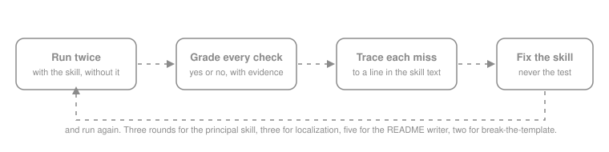
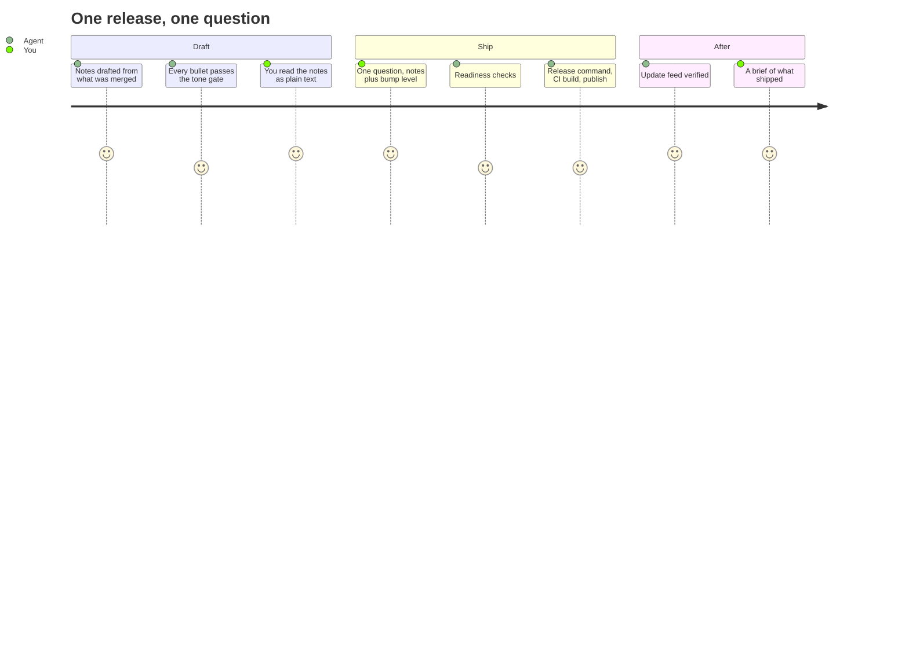
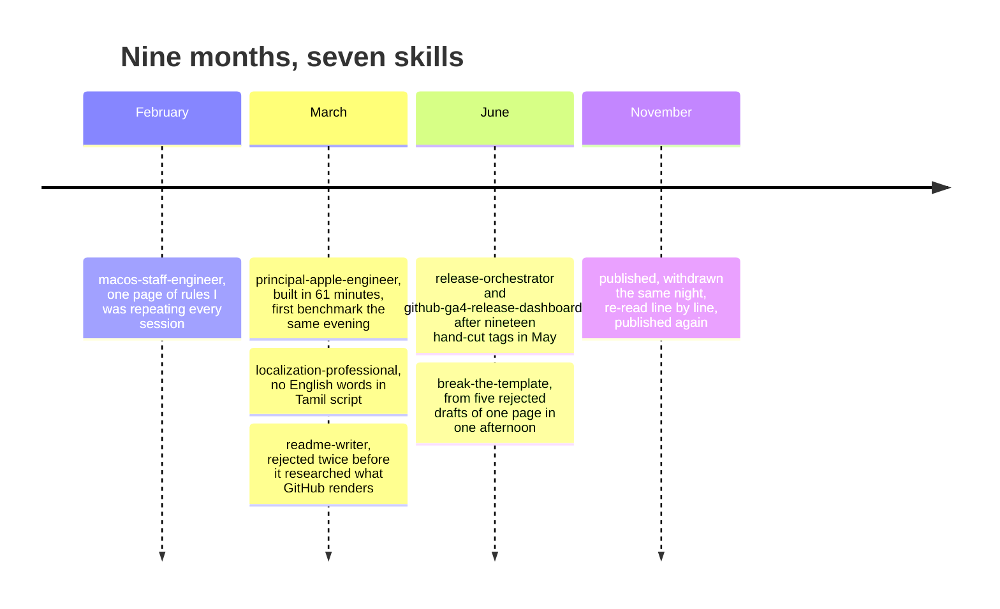

<p align="center">
  <a href="#-install"></a>&nbsp;
  <a href="#-the-skills"></a>&nbsp;
  <a href="#-benchmarks"></a>&nbsp;
  <a href="#-before-and-after"></a>&nbsp;
  <a href="#-how-a-skill-gets-tuned"></a>
</p>

<p align="center">
  
  
  <a href="https://www.skills.sh/sa74/claude-skills"></a>
  <a href="LICENSE"></a>
</p>

Skills for AI coding agents that read the [Agent Skills](https://agentskills.io) format: Claude Code, Cursor, Codex and others. Each skill is a folder with a `SKILL.md` and, where needed, reference files the agent loads on demand.

None of them were planned. Each exists because an agent got the same thing wrong often enough that I wrote the fix down. Four of the seven were then benchmarked the same way: the same tasks run with the skill loaded and without it, every check graded yes or no, and every miss traced back to a line in the skill text. The numbers, and the misses, are below.

---

## ⚡ Install

All skills:

```bash
npx skills add Sa74/claude-skills
```

One skill:

```bash
npx skills add Sa74/claude-skills --skill readme-writer
```

Add `-g` to install for every project instead of the current one.

<details>
<summary><b>Requirements and where settings live</b> — <i>two skills need two CLI tools; nothing about your project is built in</i></summary>

<br/>

`release-orchestrator` and `github-ga4-release-dashboard` need `gh` and `jq`. Each keeps its settings in one config file that it writes after asking you a few questions; nothing about your project is built into the skill.

The other five need nothing beyond the agent itself.

</details>

---

## ✨ The skills

<table>
<tr>
<td width="50%" valign="top">

> **🍎 [`principal-apple-engineer`](skills/principal-apple-engineer)**
>
> Principal-level engineering across macOS, iOS, iPadOS, tvOS, watchOS and visionOS: architecture, Swift, per-platform guidance, design systems, testing and distribution. 12 reference files.

> **🧭 [`macos-staff-engineer`](skills/macos-staff-engineer)**
>
> Working rules and a decision framework for an indie macOS app: architecture defaults, system-extension and kernel-level guidance, Swift Testing, DMG and App Store distribution.

> **📝 [`readme-writer`](skills/readme-writer)**
>
> Writing or modernising a README for any kind of project, with a library of visual patterns.

> **🎨 [`break-the-template`](skills/break-the-template)**
>
> Turning template-shaped work (articles, pages, decks, docs) into something people want to read or use.

</td>
<td width="50%" valign="top">

> **🌐 [`localization-professional`](skills/localization-professional)**
>
> Localising macOS and iOS app UI across Tamil, English (US, UK, AU), Spanish (Spain, Latin America) and German (DE, AT, CH), with a strict no-transliteration rule for Tamil.

> **🚀 [`release-orchestrator`](skills/release-orchestrator)**
>
> Shipping an app release end to end: release notes, version bump, readiness checks, your release command, the CI build, publishing and the update-feed check. Asks about your setup on first use.

> **📈 [`github-ga4-release-dashboard`](skills/github-ga4-release-dashboard)**
>
> A local HTML dashboard of release downloads from GitHub Releases, with optional active users by version from Google Analytics 4 (which covers Firebase Analytics). No other release hosts or analytics tools. Asks about your setup on first use.

</td>
</tr>
</table>

<details>
<summary><b>When does each one load?</b> — <i>the trigger phrases, in one table</i></summary>

<br/>

| Skill | Loads when you ask for |
|:---|:---|
| `principal-apple-engineer` | Anything on an Apple platform: architecture, code, review, API choice, build config, testing, release, design system |
| `macos-staff-engineer` | A macOS app decision where you want the rules stated before the code: never assume, never sugar-coat, analyse before deciding |
| `readme-writer` | "Write a README", "improve my docs", "make this repo page better" |
| `break-the-template` | "Fun", "visually engaging", "out of the box", "too much text", "you're stuck in a template", "reimagine this" |
| `localization-professional` | UI strings, `.strings`, `.stringsdict`, `.xliff`, Tamil purity, German compounds, Spanish register, English variants |
| `release-orchestrator` | "Release this", "ship v0.x", "draft release notes", or a readiness check on its own |
| `github-ga4-release-dashboard` | "How is the release doing", adoption per version, download counts, "refresh the dashboard" |

</details>

---

## 📊 Benchmarks

<p align="center">
  <picture>
    <source media="(prefers-color-scheme: dark)" srcset="assets/benchmarks-dark.svg" />
    
  </picture>
</p>

Read the gap, not the absolute score: the only difference inside each pair of bars is whether the skill was read first.

<details>
<summary><b>What each benchmark actually tested</b> — <i>the tasks behind the four bars</i></summary>

<br/>

| Skill | Tasks | Checks | What the baseline got wrong on its own |
|:---|:---|:---:|:---|
| `principal-apple-engineer` | A fitness app across iPhone, Watch and Vision Pro · a design system with Swift Testing tests · a Mac app with a Network Extension sold in and outside the App Store | 14 each | Reached for `ObservableObject`, XCTest and `DispatchQueue`; skipped `#if os()`, Reduce Motion and WatchConnectivity. Design-system task: 7 of 14 without, 14 of 14 with |
| `localization-professional` | Five UI strings into Tamil, two Germans and LATAM Spanish · a permission dialog into three Englishes, Castilian and Tamil · plural files for Tamil and German | 8 + 9 + 8 | Transliterated English into Tamil script, used informal *tú* in system UI, and once mixed Devanagari vowel signs into a Tamil word |
| `readme-writer` | A real 1,800-line README to modernise · an invented Rust vector database · an invented Go CLI | 14 + 12 + 10 | Bullet-list features, ASCII art instead of diagrams, install steps in three places, the headline number repeated four to six times, SVGs written to disk and never embedded |
| `break-the-template` | A Kubernetes migration post-mortem · an About page for a pastry chef turned data scientist · a quarter's metrics that must not be a deck | 6 each | Decorated articles and stock scrollytelling; 0 of 3 respected reduced motion; and across 48 source facts the baselines invented four, the skill runs none |

</details>

<details>
<summary><b>Read before quoting these numbers</b> — <i>one run each, model graders, and a judge that got stricter every round</i></summary>

<br/>

- **One run per configuration.** No repeats, no error bars. A one-check swing is inside the noise that was never measured.
- **The graders were models**, with a one-line reason per check. Two round-1 "failures" on the principal skill were the grader misreading its own evidence (`!isEmpty` counted as a force unwrap).
- **The grader got stricter each round**, because each round added rules for what the last one had let through. A round-1 answer that passed "uses a `ButtonStyle`" with only `.buttonStyle(.plain)` fails under round-3 rules. So round-to-round deltas are soft; the with-versus-without gap inside one round is the part that holds.
- **It measures the skill's content when read**, not whether the agent would have triggered it.
- **The README checks were rewritten every round** to match the new bar, so its five rounds are five small benchmarks, not a trend line. The bar above is the final, agent-graded round.
- **Two skills have no benchmark.** `release-orchestrator` was measured by its release log: 19 of 26 releases since June, three questions per release cut to one, the fastest clean run 24 minutes. `macos-staff-engineer` is one page of rules; 62 of the 89 lines in my global agent instructions still come from it.

</details>

---

## 🔁 Before and after

Left column: no skill. Right column: skill loaded.

<details open>
<summary><b>Tamil, before and after <code>localization-professional</code></b> — <i>seven strings, every "before" quoted from the grader's evidence</i></summary>

<br/>

| Source | Without the skill | With the skill |
|:---|:---|:---|
| microphone | ~~மைக்ரோஃபோன்~~ · transliterated | **நுண்ணொலிவாங்கி** · *checked later: in no source; now ஒலிவாங்கி* |
| buffer | ~~பைஃபர்~~ · transliterated | **இடையகம்** |
| kernel extension | ~~கர்னல்~~ நீட்டிப்பு · half English | **கருநிரல் நீட்சி** · *checked later: கருநிரல் is in no source; now flagged* |
| Sample Rate: %@ Hz | மாதிரி விகிதம்: %@ ~~Hz~~ · Latin letters | **மாதிரி வீதம்: %@ ஹெர்ட்ஸ்** · *checked later: Hz in Tamil letters; now Hz* |
| channel | ~~சேனல்~~ · transliterated | **தடம்** |
| "…your microphone", es_ES | ~~tu~~ micrófono, ~~Asegúrate~~ · informal | **su micrófono, Asegúrese** |
| "%d samples", Tamil plural | ~~மாதिरिகள्~~ · Devanagari inside a Tamil word | a Tamil word, in Tamil script only |

Each failure had a cause in the skill text and the fix was specificity: a Tamil-only exception for unit symbols, a glossary that grew from 8 rows to 31 with the wrong transliteration printed beside the right word, and an eleven-row *tú* to *usted* table in place of a one-line rule. Five edits; the failing rows above became the passing ones.

The grader had no Tamil references. Checked later against the Tamil Virtual Academy technical glossary, the University of Madras Tamil Lexicon and Tamil Wiktionary, three of those passing answers did not hold up: நுண்ணொலிவாங்கி and கருநிரல் are in none of them, and ஹெர்ட்ஸ் is the English word in Tamil letters. Every Tamil word in the skill now names its source, unit symbols stay in Latin, and a term no source has is flagged for a Tamil reader.

</details>

<details>
<summary><b>The skill was teaching what it forbade</b> — <i>why <code>principal-apple-engineer</code> scored the same twice before it moved</i></summary>

<br/>

Round 2 scored 39 of 42, exactly like round 1, with different failures. The agent grepped its own answers, then grepped the skill, and found the anti-patterns in the reference files the answers were copying from.

```diff
  // references/02 and 05: the state pattern the skill forbids, in its own examples
- final class WorkoutManager: ObservableObject {
-     @Published var heartRate: Double = 0
+ @Observable final class WorkoutManager {
+     var heartRate: Double = 0
  }

  // references/05 and 12: five force unwraps of an optional API
- let hrType = HKQuantityType.quantityType(forIdentifier: .heartRate)!
+ guard let hrType = HKQuantityType.quantityType(forIdentifier: .heartRate) else {
+     throw HealthKitError.unavailableType(.heartRate)
+ }

  // references/08: the button had no style of its own
- Button(title, action: action).buttonStyle(PlainButtonStyle())
+ struct PrimaryButtonStyle: ButtonStyle {
+     func makeBody(configuration: Configuration) -> some View { … }
+ }

  // references/04 and 10: the one gap nobody's knowledge covered
+ The .systemextension lives at YourApp.app/Contents/Library/SystemExtensions/
```

Round 3: 41 of 42. The last miss, three `DispatchQueue.main.async` calls inside delegate callbacks, has a known fix that was never applied.

</details>

<details>
<summary><b>What a README looks like with and without <code>readme-writer</code></b> — <i>the final, agent-graded round</i></summary>

<br/>

| | Without the skill | With the skill |
|:---|:---|:---|
| Features | Bullet list | HTML grid or blockquote cards |
| Diagrams | ASCII art | Two or more Mermaid types |
| Secondary detail | Inline, all of it | Collapsible sections with a summary that promises something |
| Installation | Scattered over three sections | One section, all methods inside |
| Headline number | Repeated four to six times | At most twice |
| SVG assets | Written to disk, never embedded | Created and referenced, light and dark |
| On a real 1,800-line README | 7 of 12 checks, same as the original it rewrote | 12 of 12 |

The turn that mattered was not a rule. After two rounds that passed their own checks and were still rejected ("nothing modern or fun or interactive"), the agent went and researched what GitHub actually renders: style tags and scripts are stripped, so animation has to live inside a separate SVG embedded as an image, where CSS keyframes do run. That research became the skill's [visual patterns reference](skills/readme-writer/references/visual-patterns.md).

</details>

<details>
<summary><b>What the baselines invented, and <code>break-the-template</code> didn't</b> — <i>48 facts audited across three briefs</i></summary>

<br/>

| Brief | Without the skill | With the skill |
|:---|:---|:---|
| Kubernetes post-mortem | A polished scrolling article with hero statistics. Invented an uptime counter reading "2,191 days" | A terminal you operate: "relive it in 10 commands" |
| Pastry chef turned data scientist | A recipe card. Invented "27 layers" and a `pip install` for a package that does not exist | "Most About pages are a wall of text. Mine is a croissant." The page unfolds |
| Quarterly metrics, not a deck | Scrollytelling chapters. Invented "a day of collective user waiting returned every day" | The quarter as a phone home screen; each metric is an app you open |

Both sides kept 47 of the 48 source facts. The skill's one drop, "3 years as head pastry chef", became the rule that you write the fact manifest before you design. The baselines' four inventions became the rule that creativity spends on form, never on data.

</details>

---

## 🛠 How a skill gets tuned

<p align="center">
  
</p>

<details>
<summary><b>Twelve failures and the rule each one became</b> — <i>this is the whole method</i></summary>

<br/>

| Skill | What went wrong | What the skill says now |
|:---|:---|:---|
| `localization-professional` | "Hz" left in Latin letters inside a Tamil string; two rules contradicted each other | Unit symbols stay in Latin in every locale. The first fix spelled them in Tamil letters (ஹெர்ட்ஸ்), the transliteration the skill bans |
| `localization-professional` | "Microphone" came back as a sound-alike | A glossary where every Tamil word names a published source; a term no source has is flagged for a Tamil reader, never built. The first fix built words instead |
| `localization-professional` | Castilian UI addressed the user as *tú* | An eleven-row *tú* to *usted* conjugation table and a red-flag scan before returning |
| `principal-apple-engineer` | The reference files used the patterns the rules forbid | References rewritten; the force-unwrap rule names the optional APIs that trap people |
| `principal-apple-engineer` | Nobody stated where a system extension bundle lives | The path, in two references |
| `readme-writer` | SVGs referenced that were never written | If you reference a file, create it, in both theme variants |
| `readme-writer` | One statistic in a badge, a caption and the prose; install steps in three places | A data point appears once; installation lives in one section |
| `break-the-template` | A seniority fact dropped while compressing | Inventory every fact before designing; verify each survived after building |
| `break-the-template` | Baselines fabricated numbers to decorate | Invent nothing; make jokes with form, never with data |
| `release-orchestrator` | The agent asked three questions per release; the bare scripts asked once | Exactly one combined gate: notes plus bump level; its answer authorises the whole chain |
| `release-orchestrator` | Dry changelog bullets, asked to fix eight times in five months | A mandatory tone gate: read the last shipped notes first, reject any bullet that could appear unchanged in any app's changelog |
| `github-ga4-release-dashboard` | Every auto-update counted as a download | A separately named update asset, so organic and updater traffic split into their own tiles |

</details>

<details>
<summary><b>A release with <code>release-orchestrator</code></b> — <i>one question from you, start to finish</i></summary>

<br/>



</details>

---

## 🗓 Where they came from



The long version, with every round and every miss, is on my blog: [Things I Kept Telling the AI](https://sasimoorthy.com/blog/things-i-kept-telling-the-ai).

---

## Licence

[MIT](LICENSE)


