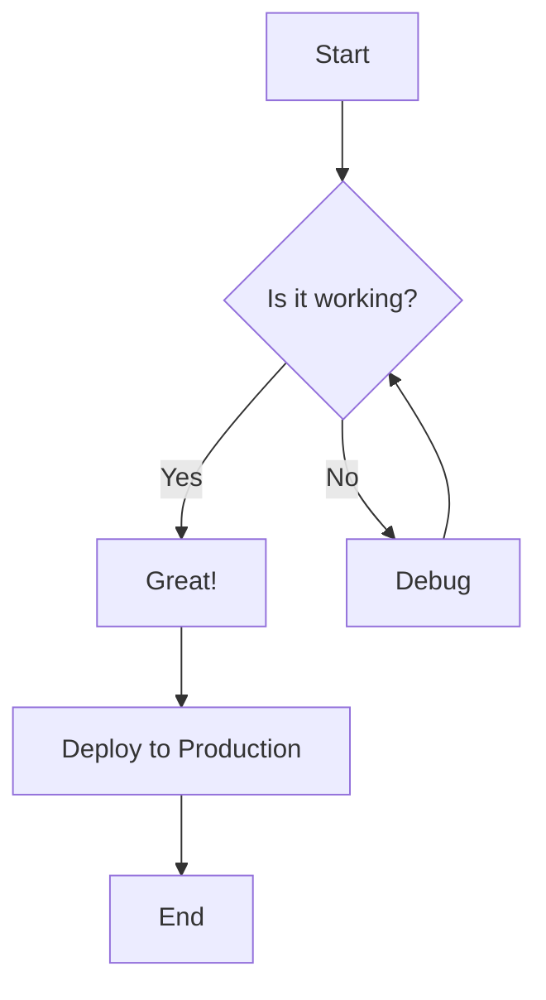
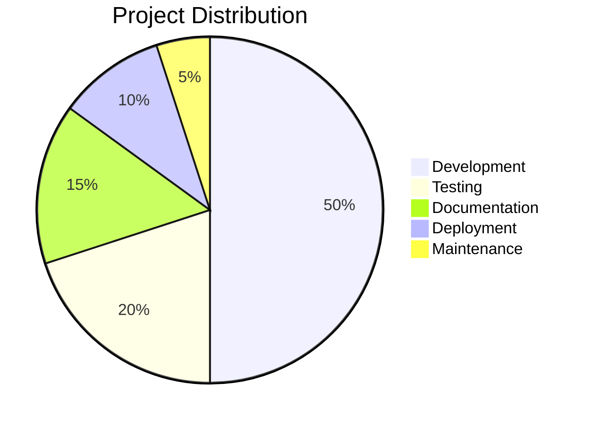
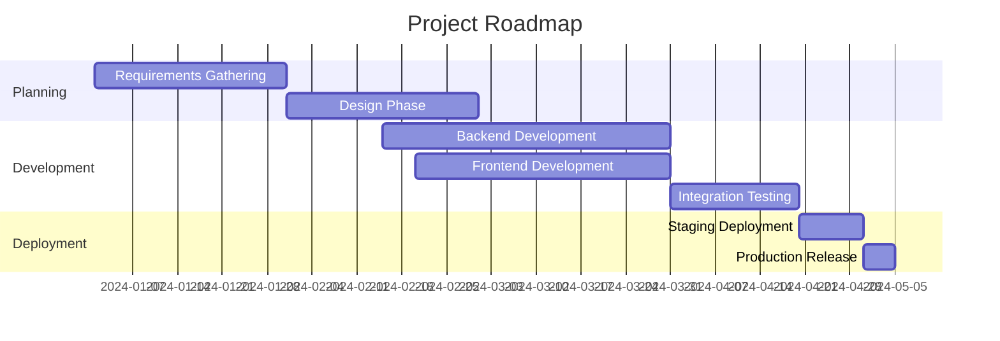
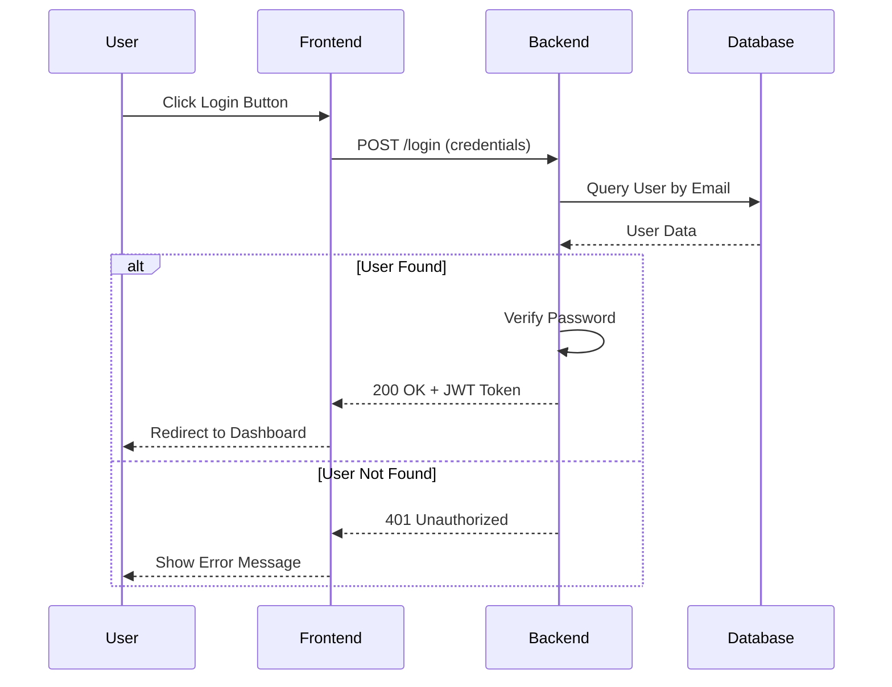
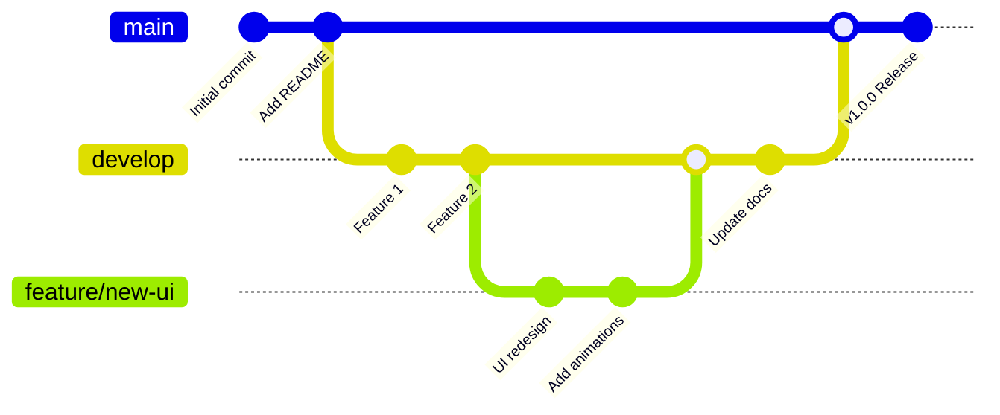
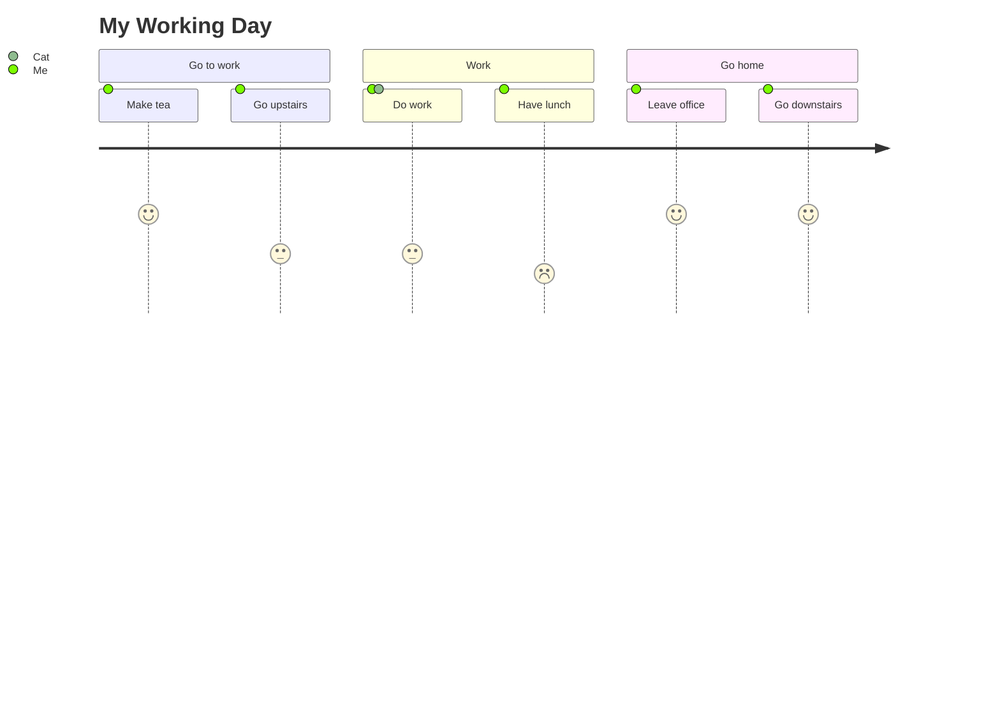
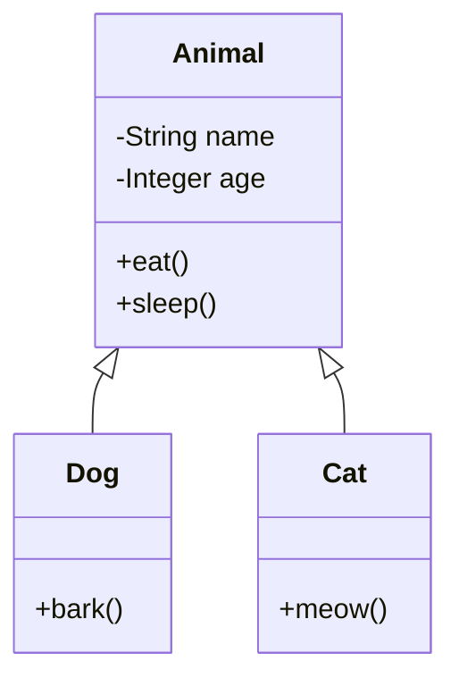
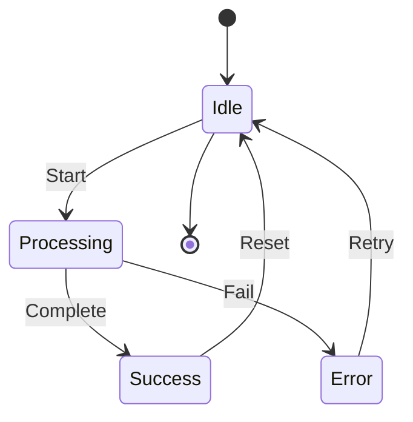

# GitHub README Visual Patterns Reference

A comprehensive guide to the most visually impressive and interactive patterns that actually work when rendered on GitHub. This document focuses on patterns that render correctly on github.com, not just in local markdown viewers.

---

## Table of Contents

1. [Animated SVGs in READMEs](#1-animated-svgs-in-readmes)
2. [SVG Data Visualizations](#2-svg-data-visualizations)
3. [Unicode and HTML Visual Elements](#3-unicode--html-visual-elements)
4. [Mermaid Diagrams](#4-mermaid-diagrams)
5. [Terminal Window Mockups](#5-terminal-window-mockups)
6. [GitHub-Specific Tricks](#6-github-specific-tricks)
7. [Activity and Stats Visualizations](#7-activity--stats-visualizations)

---

## 1. Animated SVGs in READMEs

### What Works on GitHub

GitHub renders SVG files including CSS animations. You can embed SVGs with `<style>` tags containing `@keyframes` rules directly in SVG code. Animations include:
- Transform animations (rotate, translate, scale)
- Fill color changes
- Opacity animations
- Stroke animations
- Custom timing functions (cubic-bezier, ease, etc.)

### Key Constraint

GitHub sanitizes markdown HTML but allows SVG files to be rendered as images. The SVG must be:
1. A separate `.svg` file in your repository
2. Included in your README as an `` tag or markdown image link
3. Contains inline `<style>` tags with CSS animations

Direct `<style>` tags in markdown won't work—GitHub strips them for security.

### Example 1: Typing Animation

Create a file named `typing-animation.svg`:

```xml
<svg xmlns="http://www.w3.org/2000/svg" viewBox="0 0 600 100">
  <style>
    @keyframes typing {
      0% { width: 0; }
      100% { width: 100%; }
    }
    @keyframes blink {
      0%, 100% { border-right-color: #000; }
      50% { border-right-color: transparent; }
    }
    .typing-text {
      font-family: 'Courier New', monospace;
      font-size: 24px;
      color: #333;
      white-space: nowrap;
      overflow: hidden;
      border-right: 3px solid #000;
      animation: typing 3.5s steps(40, end), blink 0.75s step-end infinite;
      width: 100%;
    }
  </style>
  <text class="typing-text" x="10" y="50">Hello, I am being typed out!</text>
</svg>
```

**Reference in README:**
```markdown

```

### Example 2: Wave Animation

Create `wave-animation.svg`:

```xml
<svg xmlns="http://www.w3.org/2000/svg" viewBox="0 0 300 100">
  <style>
    @keyframes wave {
      0%, 100% { transform: translateY(0px); }
      25% { transform: translateY(-10px); }
      50% { transform: translateY(0px); }
    }
    .wave-text {
      font-family: Arial, sans-serif;
      font-size: 48px;
      font-weight: bold;
      animation: wave 1.5s ease-in-out infinite;
    }
    text:nth-of-type(1) { animation-delay: 0s; fill: #FF6B6B; }
    text:nth-of-type(2) { animation-delay: 0.1s; fill: #4ECDC4; }
    text:nth-of-type(3) { animation-delay: 0.2s; fill: #45B7D1; }
    text:nth-of-type(4) { animation-delay: 0.3s; fill: #FFA07A; }
    text:nth-of-type(5) { animation-delay: 0.4s; fill: #98D8C8; }
  </style>
  <text class="wave-text" x="10" y="60">👋</text>
  <text class="wave-text" x="60" y="60">H</text>
  <text class="wave-text" x="90" y="60">i</text>
  <text class="wave-text" x="120" y="60">!</text>
</svg>
```

### Example 3: Progress Animation

Create `progress-animation.svg`:

```xml
<svg xmlns="http://www.w3.org/2000/svg" viewBox="0 0 400 60">
  <style>
    @keyframes progress {
      0% { stroke-dashoffset: 400; }
      100% { stroke-dashoffset: 0; }
    }
    .progress-bar {
      stroke-dasharray: 400;
      animation: progress 4s ease-in-out infinite;
      stroke-linecap: round;
    }
    .progress-text {
      font-family: Arial, sans-serif;
      font-size: 12px;
      fill: #666;
    }
  </style>

  <!-- Background track -->
  <rect x="20" y="20" width="360" height="20" rx="10" fill="#e0e0e0"/>

  <!-- Animated progress bar -->
  <rect class="progress-bar" x="20" y="20" width="360" height="20"
        rx="10" fill="none" stroke="#4CAF50" stroke-width="20"/>

  <text class="progress-text" x="200" y="50" text-anchor="middle">Loading...</text>
</svg>
```

### Example 4: Rotating Logo

Create `rotating-logo.svg`:

```xml
<svg xmlns="http://www.w3.org/2000/svg" viewBox="0 0 200 200">
  <style>
    @keyframes spin {
      0% { transform: rotate(0deg); }
      100% { transform: rotate(360deg); }
    }
    .spinning-circle {
      animation: spin 2s linear infinite;
      transform-origin: 100px 100px;
    }
  </style>

  <g class="spinning-circle">
    <circle cx="100" cy="100" r="80" fill="none" stroke="#FF5722" stroke-width="4"/>
    <circle cx="100" cy="100" r="70" fill="none" stroke="#2196F3" stroke-width="3"
            stroke-dasharray="30 10" opacity="0.8"/>
  </g>

  <text x="100" y="110" text-anchor="middle" font-size="24" font-weight="bold" fill="#333">
    DEV
  </text>
</svg>
```

### CSS Animation Properties Supported

- `animation-duration`
- `animation-delay`
- `animation-iteration-count` (works with `infinite`)
- `animation-timing-function` (ease, linear, cubic-bezier, etc.)
- `transform`: rotate, translate, scale, skew
- `fill`, `stroke`, `opacity`
- `stroke-dasharray` and `stroke-dashoffset` (for drawing animations)

**What doesn't work:**
- JavaScript animations
- `<script>` tags
- External stylesheets
- Some advanced CSS features (filters, gradients in some cases)

---

## 2. SVG Data Visualizations

### Example 1: Bar Chart

Create `bar-chart.svg`:

```xml
<svg xmlns="http://www.w3.org/2000/svg" viewBox="0 0 400 300">
  <defs>
    <linearGradient id="barGradient" x1="0%" y1="0%" x2="0%" y2="100%">
      <stop offset="0%" style="stop-color:#4CAF50;stop-opacity:1" />
      <stop offset="100%" style="stop-color:#81C784;stop-opacity:1" />
    </linearGradient>
  </defs>

  <!-- Title -->
  <text x="200" y="25" font-size="20" font-weight="bold" text-anchor="middle" fill="#333">
    Monthly Sales
  </text>

  <!-- Y-axis labels -->
  <text x="35" y="270" font-size="12" fill="#999">0</text>
  <text x="20" y="190" font-size="12" fill="#999">250K</text>
  <text x="20" y="110" font-size="12" fill="#999">500K</text>

  <!-- Grid lines -->
  <line x1="40" y1="260" x2="380" y2="260" stroke="#eee" stroke-width="1"/>
  <line x1="40" y1="180" x2="380" y2="180" stroke="#eee" stroke-width="1"/>
  <line x1="40" y1="100" x2="380" y2="100" stroke="#eee" stroke-width="1"/>

  <!-- Bars -->
  <rect x="60" y="160" width="40" height="100" fill="url(#barGradient)"/>
  <text x="80" y="275" font-size="12" text-anchor="middle" fill="#666">Jan</text>

  <rect x="120" y="120" width="40" height="140" fill="url(#barGradient)"/>
  <text x="140" y="275" font-size="12" text-anchor="middle" fill="#666">Feb</text>

  <rect x="180" y="80" width="40" height="180" fill="url(#barGradient)"/>
  <text x="200" y="275" font-size="12" text-anchor="middle" fill="#666">Mar</text>

  <rect x="240" y="100" width="40" height="160" fill="url(#barGradient)"/>
  <text x="260" y="275" font-size="12" text-anchor="middle" fill="#666">Apr</text>

  <rect x="300" y="140" width="40" height="120" fill="url(#barGradient)"/>
  <text x="320" y="275" font-size="12" text-anchor="middle" fill="#666">May</text>

  <!-- Axes -->
  <line x1="40" y1="60" x2="40" y2="260" stroke="#333" stroke-width="2"/>
  <line x1="40" y1="260" x2="380" y2="260" stroke="#333" stroke-width="2"/>
</svg>
```

### Example 2: Pie Chart

Create `pie-chart.svg`:

```xml
<svg xmlns="http://www.w3.org/2000/svg" viewBox="0 0 400 300">
  <style>
    .slice-label { font-family: Arial; font-size: 12px; font-weight: bold; fill: white; }
    .legend-text { font-family: Arial; font-size: 14px; fill: #333; }
    .legend-box { stroke: #999; stroke-width: 1; }
  </style>

  <!-- Title -->
  <text x="150" y="25" font-size="18" font-weight="bold" fill="#333">Project Distribution</text>

  <!-- Pie slices (using path elements with arc commands) -->
  <!-- Slice 1: 50% (Development) - 180 degrees -->
  <path d="M 150 150 L 150 50 A 100 100 0 0 1 150 250 Z" fill="#FF6B6B"/>
  <text class="slice-label" x="130" y="110">50%</text>

  <!-- Slice 2: 20% (Testing) - 72 degrees -->
  <path d="M 150 150 L 150 50 A 100 100 0 0 1 219 69 Z" fill="#4ECDC4"/>
  <text class="slice-label" x="175" y="85">20%</text>

  <!-- Slice 3: 15% (Documentation) - 54 degrees -->
  <path d="M 150 150 L 219 69 A 100 100 0 0 1 250 156 Z" fill="#45B7D1"/>
  <text class="slice-label" x="230" y="105">15%</text>

  <!-- Slice 4: 10% (Deployment) - 36 degrees -->
  <path d="M 150 150 L 250 156 A 100 100 0 0 1 219 231 Z" fill="#FFA07A"/>
  <text class="slice-label" x="215" y="200">10%</text>

  <!-- Slice 5: 5% (Maintenance) - 18 degrees -->
  <path d="M 150 150 L 219 231 A 100 100 0 0 1 150 250 Z" fill="#98D8C8"/>

  <!-- Legend -->
  <rect class="legend-box" x="280" y="60" width="100" height="120" fill="#f9f9f9"/>

  <rect x="290" y="70" width="12" height="12" fill="#FF6B6B"/>
  <text class="legend-text" x="310" y="79">Development</text>

  <rect x="290" y="90" width="12" height="12" fill="#4ECDC4"/>
  <text class="legend-text" x="310" y="99">Testing</text>

  <rect x="290" y="110" width="12" height="12" fill="#45B7D1"/>
  <text class="legend-text" x="310" y="119">Documentation</text>

  <rect x="290" y="130" width="12" height="12" fill="#FFA07A"/>
  <text class="legend-text" x="310" y="139">Deployment</text>

  <rect x="290" y="150" width="12" height="12" fill="#98D8C8"/>
  <text class="legend-text" x="310" y="159">Maintenance</text>
</svg>
```

### Example 3: Gauge Chart

Create `gauge-chart.svg`:

```xml
<svg xmlns="http://www.w3.org/2000/svg" viewBox="0 0 300 200">
  <style>
    @keyframes fillGauge {
      0% { stroke-dashoffset: 251; }
      100% { stroke-dashoffset: 88; }
    }
    .gauge-fill {
      animation: fillGauge 2s ease-in-out forwards;
    }
    .gauge-text { font-family: Arial; font-size: 32px; font-weight: bold; fill: #333; }
    .gauge-label { font-family: Arial; font-size: 14px; fill: #999; }
  </style>

  <!-- Background gauge -->
  <circle cx="150" cy="150" r="80" fill="none" stroke="#e0e0e0" stroke-width="15"
          stroke-linecap="round" transform="rotate(-90 150 150)"/>

  <!-- Filled gauge (75%) -->
  <circle class="gauge-fill" cx="150" cy="150" r="80" fill="none" stroke="#4CAF50"
          stroke-width="15" stroke-linecap="round" stroke-dasharray="251"
          transform="rotate(-90 150 150)"/>

  <!-- Center circle -->
  <circle cx="150" cy="150" r="50" fill="white" stroke="#ddd" stroke-width="2"/>

  <!-- Percentage text -->
  <text class="gauge-text" x="150" y="165" text-anchor="middle">75%</text>
  <text class="gauge-label" x="150" y="180" text-anchor="middle">Complete</text>

  <!-- Scale labels -->
  <text class="gauge-label" x="70" y="160">0%</text>
  <text class="gauge-label" x="225" y="160">100%</text>
</svg>
```

### Example 4: Sparkline (Trend Line)

Create `sparkline.svg`:

```xml
<svg xmlns="http://www.w3.org/2000/svg" viewBox="0 0 300 60">
  <style>
    .trend-line {
      stroke: #2196F3;
      stroke-width: 2;
      fill: none;
      stroke-linecap: round;
      stroke-linejoin: round;
    }
    .trend-fill {
      fill: url(#trendGradient);
      opacity: 0.3;
    }
    .trend-label { font-family: Arial; font-size: 12px; fill: #666; }
  </style>

  <defs>
    <linearGradient id="trendGradient" x1="0%" y1="0%" x2="0%" y2="100%">
      <stop offset="0%" style="stop-color:#2196F3;stop-opacity:0.5" />
      <stop offset="100%" style="stop-color:#2196F3;stop-opacity:0" />
    </linearGradient>
  </defs>

  <!-- Grid -->
  <line x1="0" y1="30" x2="300" y2="30" stroke="#f0f0f0" stroke-width="1"/>

  <!-- Trend area fill -->
  <path class="trend-fill" d="M 0 30 L 10 25 L 20 28 L 30 18 L 40 22 L 50 15 L 60 20 L 70 12 L 80 8 L 90 5 L 100 10 L 110 3 L 120 6 L 130 1 L 140 4 L 150 2 L 160 8 L 170 5 L 180 10 L 190 8 L 200 12 L 210 9 L 220 15 L 230 12 L 240 18 L 250 15 L 260 20 L 270 18 L 280 22 L 290 20 L 300 25 L 300 50 L 0 50 Z"/>

  <!-- Trend line -->
  <polyline class="trend-line" points="0 30 10 25 20 28 30 18 40 22 50 15 60 20 70 12 80 8 90 5 100 10 110 3 120 6 130 1 140 4 150 2 160 8 170 5 180 10 190 8 200 12 210 9 220 15 230 12 240 18 250 15 260 20 270 18 280 22 290 20 300 25"/>

  <!-- Labels -->
  <text class="trend-label" x="5" y="50">Low</text>
  <text class="trend-label" x="280" y="50">High</text>
</svg>
```

---

## 3. Unicode & HTML Visual Elements

### Example 1: Progress Bars with Unicode Blocks

```markdown
## Installation Progress

Progress: ████████████████░░░░░░░░░░░░░░░░░░░░░░░░░░░░░░ 35%

Complete: ██████████████████████████████████████████████████ 100%

Database Migration: ████████░░░░░░░░░░░░░░░░░░░░░░░░░░░░░░░░░░░░░ 18%

Testing: ██████████████████░░░░░░░░░░░░░░░░░░░░░░░░░░░░░░░░ 36%
```

### Unicode Block Characters Reference

```
Full block: █
Dark shade: ▓
Medium shade: ▒
Light shade: ░
Left half block: ▌
Right half block: ▐
Upper half block: ▀
Lower half block: ▄

Vertical bars:
▁ ▂ ▃ ▄ ▅ ▆ ▇ █

Horizontal bars:
▏ ▎ ▍ ▌ ▋ ▊ ▉ █

Quarter blocks:
▖ ▗ ▘ ▝

Box drawing:
├ ├ ─ ─ ─ ─ ─ ─ ┤
│ Content │
└ ─ ─ ─ ─ ─ ─ ─ ┘
```

### Example 2: Star Rating

```markdown
⭐⭐⭐⭐⭐ 5.0/5.0 (1,234 reviews)
⭐⭐⭐⭐☆ 4.0/5.0 (567 reviews)
⭐⭐⭐☆☆ 3.0/5.0 (89 reviews)
```

### Example 3: Visual Timeline

```markdown
2022 ──●────────────────────────────
      Project Started

2023 ────●─●──●──────────────────
      Q1    Q2  Q3
      Version 1.0 Released

2024 ──────────●─●─●──────────────
               Q1 Q2 Q3
               Major updates

2025 ─────────────────●─────────
                     Q1
                     Current
```

### Example 4: Checkmarks and Symbols

```markdown
## Checklist

- [x] Feature complete
- [x] Tests written
- [x] Documentation done
- [ ] Performance optimized
- [ ] Production deployment pending

## Status Indicators

✅ Success
❌ Failed
⚠️  Warning
❓ Unknown
🚀 In Progress
🔧 Under Maintenance
```

### Example 5: Simple Box Design

```markdown
┌─────────────────────────────┐
│  Welcome to My Project       │
│                              │
│  This is a simple box        │
│  created with box drawing    │
│  Unicode characters          │
└─────────────────────────────┘

╔═════════════════════════════╗
║  Premium Version            ║
║  ✓ Feature A               ║
║  ✓ Feature B               ║
║  ✓ Feature C               ║
╚═════════════════════════════╝
```

---

## 4. Mermaid Diagrams

GitHub natively supports Mermaid diagrams in markdown using fenced code blocks with `mermaid` language identifier.

### Example 1: Flowchart

```markdown

```

### Example 2: Pie Chart

```markdown

```

### Example 3: Gantt Chart (Project Timeline)

```markdown

```

### Example 4: Sequence Diagram

```markdown

```

### Example 5: Git Graph (Branch History)

```markdown

```

### Example 6: Journey Diagram (User Journey)

```markdown

```

### Example 7: Class Diagram

```markdown

```

### Example 8: State Diagram

```markdown

```

---

## 5. Terminal Window Mockups

The key to creating terminal mockups is using SVG with `foreignObject` to embed HTML and CSS. However, GitHub also supports simple ASCII/Unicode terminal styling.

### Example 1: Simple ASCII Terminal

```markdown
```
$ npm install my-package
npm WARN old lockfile
npm notice created a lockfile as package-lock.json
added 1 package, and audited 2 packages in 1s

$ npm run build
> my-package@1.0.0 build
> webpack --mode production

webpack 5.88.0 compiled successfully in 8234ms
```
```

### Example 2: Terminal Window with HTML/SVG (Advanced)

Create a file `terminal-window.svg`:

```xml
<svg xmlns="http://www.w3.org/2000/svg" xmlns:xhtml="http://www.w3.org/1999/xhtml"
     viewBox="0 0 600 400">
  <defs>
    <style>
      .terminal-bg { fill: #1e1e1e; }
      .terminal-border { fill: #333; }
      .terminal-text { font-family: 'Courier New', monospace; font-size: 13px; fill: #00ff00; }
      .terminal-title { fill: #fff; font-family: Arial; font-size: 12px; }
      .terminal-button { fill: #888; }
      .terminal-prompt { fill: #ffff00; }
    </style>
  </defs>

  <!-- Outer border/frame -->
  <rect class="terminal-bg" x="0" y="0" width="600" height="400" rx="8"/>

  <!-- Title bar -->
  <rect class="terminal-border" x="0" y="0" width="600" height="30" rx="8"/>

  <!-- Buttons -->
  <circle class="terminal-button" cx="15" cy="15" r="5"/>
  <circle class="terminal-button" cx="35" cy="15" r="5"/>
  <circle class="terminal-button" cx="55" cy="15" r="5"/>

  <!-- Title text -->
  <text class="terminal-title" x="300" y="21" text-anchor="middle">bash — 80x30</text>

  <!-- Terminal content using foreignObject -->
  <foreignObject x="10" y="35" width="580" height="355">
    <xhtml:div style="color: #00ff00; background: #1e1e1e; font-family: 'Courier New', monospace;
                      font-size: 13px; padding: 10px; overflow: hidden; height: 100%;">
      <div>$ <span style="color: #ffff00;">npm</span> install express</div>
      <div style="color: #aaa;">added 50 packages in 3.2s</div>
      <div></div>
      <div>$ <span style="color: #ffff00;">npm</span> start</div>
      <div style="color: #00aa00;">&gt; app@1.0.0 start</div>
      <div style="color: #00aa00;">&gt; node server.js</div>
      <div></div>
      <div style="color: #00ffff;">✓ Server running on http://localhost:3000</div>
      <div style="color: #00ffff;">✓ Connected to database</div>
      <div></div>
      <div>$ <span style="color: #ffff00;">_</span></div>
    </xhtml:div>
  </foreignObject>
</svg>
```

### Example 3: Code Block Styled Terminal

```markdown
```bash
$ git clone https://github.com/user/repo.git
Cloning into 'repo'...
remote: Counting objects: 100% (245/245), done.
remote: Compressing objects: 100% (120/120), done.
Receiving objects: 100% (245/245), 2.3 MiB | 5.2 MiB/s

$ cd repo && npm install
npm notice created a lockfile as package-lock.json
added 234 packages in 45s
```
```

---

## 6. GitHub-Specific Tricks

### Example 1: Picture Element for Dark/Light Mode

This is the modern recommended approach. Place this in your README:

```html
<picture>
  <source media="(prefers-color-scheme: dark)" srcset="https://user-images.githubusercontent.com/...dark-image.png">
  <source media="(prefers-color-scheme: light)" srcset="https://user-images.githubusercontent.com/...light-image.png">
  
</picture>
```

**How it works:**
- When GitHub is in dark mode, the dark image loads
- When GitHub is in light mode, the light image loads
- Falls back to default image if picture element isn't supported

### Example 2: Dark/Light Mode SVG with prefers-color-scheme

Create `logo-adaptive.svg`:

```xml
<svg xmlns="http://www.w3.org/2000/svg" viewBox="0 0 200 200">
  <style>
    @media (prefers-color-scheme: dark) {
      .text { fill: #ffffff; }
      .bg { fill: #1e1e1e; }
      .accent { fill: #00ff00; }
    }
    @media (prefers-color-scheme: light) {
      .text { fill: #000000; }
      .bg { fill: #ffffff; }
      .accent { fill: #0066cc; }
    }
  </style>

  <rect class="bg" width="200" height="200"/>
  <circle class="accent" cx="100" cy="100" r="80"/>
  <text class="text" x="100" y="110" text-anchor="middle" font-size="32" font-weight="bold">
    Logo
  </text>
</svg>
```

### Example 3: GitHub Stats and Activity Widgets

Use dynamically generated services that return SVG images:

```markdown
## GitHub Stats

[](https://github.com/ashutosh00710/github-readme-activity-graph)

[](https://github.com/anuraghazra/github-readme-stats)

[](https://github.com/anuraghazra/github-readme-stats)
```

### Example 4: YouTube and Media Cards

For actual embedding, use the `<video>` tag with GitHub Releases:

```html
<video width="640" height="360" controls>
  <source src="https://github.com/YOUR_USERNAME/YOUR_REPO/releases/download/v1.0/demo.mp4" type="video/mp4">
  Your browser does not support the video tag.
</video>
```

**Important:** The video URL must use `githubusercontent.com` domain. Direct repository paths won't work.

### Example 5: Custom Styling with CSS in SVG

Create styled-content.svg using foreignObject:

```xml
<svg xmlns="http://www.w3.org/2000/svg" xmlns:xhtml="http://www.w3.org/1999/xhtml"
     viewBox="0 0 400 300">
  <style>
    .card {
      background: linear-gradient(135deg, #667eea 0%, #764ba2 100%);
      padding: 20px;
      border-radius: 8px;
      color: white;
    }
    .card-title { font-size: 24px; font-weight: bold; margin-bottom: 10px; }
    .card-text { font-size: 14px; opacity: 0.9; }
  </style>

  <foreignObject x="20" y="20" width="360" height="260">
    <xhtml:div class="card">
      <div class="card-title">Welcome!</div>
      <div class="card-text">
        This is a styled card created with SVG and HTML.
        You can use gradients, custom fonts, and more!
      </div>
    </xhtml:div>
  </foreignObject>
</svg>
```

---

## 7. Activity & Stats Visualizations

### Example 1: GitHub Contribution Graph (DIY Version)

Create `contribution-graph.svg`:

```xml
<svg xmlns="http://www.w3.org/2000/svg" viewBox="0 0 920 128">
  <style>
    .day { rx: 2; }
    .level-0 { fill: #ebedf0; }
    .level-1 { fill: #c6e48b; }
    .level-2 { fill: #7bc96f; }
    .level-3 { fill: #239a3b; }
    .level-4 { fill: #196127; }
    .month { font-size: 12px; fill: #24292e; }
  </style>

  <!-- Week columns with contribution density -->
  <g id="week1">
    <rect class="day level-0" x="0" y="0" width="12" height="12"/>
    <rect class="day level-2" x="0" y="14" width="12" height="12"/>
    <rect class="day level-3" x="0" y="28" width="12" height="12"/>
    <rect class="day level-1" x="0" y="42" width="12" height="12"/>
    <rect class="day level-4" x="0" y="56" width="12" height="12"/>
    <rect class="day level-2" x="0" y="70" width="12" height="12"/>
    <rect class="day level-0" x="0" y="84" width="12" height="12"/>
  </g>

  <!-- Repeat for more weeks with different patterns -->
  <!-- This represents a contribution calendar -->

  <!-- Month labels -->
  <text class="month" x="20" y="120">Jan</text>
  <text class="month" x="80" y="120">Feb</text>
  <text class="month" x="140" y="120">Mar</text>
</svg>
```

### Example 2: Repository Stats Dashboard

```markdown
## 📊 Repository Stats

| Metric | Value |
|--------|-------|
| Stars | ⭐ 2.5K |
| Forks | 🍴 450 |
| Watchers | 👀 180 |
| Issues | 📋 23 |
| Pull Requests | 🔀 12 |
| Contributors | 👥 45 |
| License | MIT |

### Activity

- **Last Updated**: 2 days ago
- **Latest Release**: v1.2.3 (2 weeks ago)
- **Build Status**: ✅ Passing
- **Code Coverage**: 87%
```

### Example 3: Streak Counter

```markdown

```

This uses an external service that generates dynamic SVG images showing:
- Current streak count
- Longest streak
- Contribution counts
- Customizable themes

### Example 4: Star History Chart

```markdown
[](https://star-history.com/#USER/REPO&Date)
```

This generates an interactive SVG showing:
- Stars over time
- Growth trends
- Comparison with other repos

---

## Tips and Best Practices

### General Guidelines

1. **Performance**: Keep SVG file sizes under 50KB for optimal GitHub rendering
2. **Accessibility**: Always include descriptive `alt` text for images
3. **Fallbacks**: Provide text-based alternatives to visual elements
4. **Testing**: Test on both light and dark GitHub themes

### SVG Optimization

```bash
# Use tools like svgo to minimize SVG files
npm install -g svgo
svgo chart.svg -o chart.min.svg
```

### Browser Compatibility

- **Picture element**: Supported in all modern browsers and GitHub
- **SVG animations**: Supported (but test in dark mode)
- **Mermaid**: Native GitHub support since 2022
- **HTML in SVG**: Using foreignObject, widely supported

### What Doesn't Work

- Direct `<style>` tags in markdown
- JavaScript execution
- External script sources
- Form submission in README
- CSS libraries that require script initialization
- Complex HTML that requires JavaScript rendering

### Recommended Approaches

1. **For animations**: Use SVG with embedded CSS @keyframes
2. **For charts**: Use Mermaid or inline SVG
3. **For stats**: Use external services that return SVG images
4. **For styling**: Use SVG + foreignObject for rich HTML/CSS
5. **For dark mode**: Use picture element or prefers-color-scheme in SVG

---

## External Resources and Tools

### Dynamic Content Generators

- **GitHub README Stats**: Generates GitHub stats as SVG
- **GitHub Activity Graph**: Shows last 31 days of activity
- **Star History**: Charts repository stars over time
- **Readme Typing SVG**: Creates typing/animated text effects
- **Spotify Recently Played**: Shows your Spotify listening activity

### SVG and Animation Tools

- **SVGO**: SVG optimizer for reducing file size
- **Framer**: Design and export animations
- **Excalidraw**: Draw diagrams and export as SVG
- **Draw.io**: Diagram tool with SVG export

### Mermaid Resources

- **Official Mermaid Documentation**: https://mermaid.js.org
- **Mermaid Live Editor**: https://mermaid.live
- **Mermaid GitHub**: https://github.com/mermaid-js/mermaid

---

## Examples in the Wild

Look for inspiration in these high-quality GitHub READMEs:

- **Awesome projects** with creative READMEs often use combinations of:
  - Animated hero SVGs
  - Mermaid architecture diagrams
  - GitHub stats widgets
  - Terminal mockups for code examples
  - Unicode progress indicators
  - Feature comparison tables with visual elements

---

## Summary

| Pattern | Best For | Works on GitHub |
|---------|----------|-----------------|
| Animated SVG | Logos, loading states, attention | ✅ Yes |
| SVG Charts | Data visualization | ✅ Yes |
| Unicode Elements | Progress bars, simple graphics | ✅ Yes |
| Mermaid | Flowcharts, architecture diagrams | ✅ Yes |
| Terminal Mockups | Code examples, CLI tools | ✅ Yes (ASCII) |
| Picture Element | Dark/light mode images | ✅ Yes |
| SVG + foreignObject | Rich HTML styling | ✅ Yes |
| Stats Widgets | GitHub metrics | ✅ Yes (via services) |

---

**Last Updated**: April 2025
**GitHub Support**: Verified with current GitHub rendering engine
**License**: Reference document for public use
